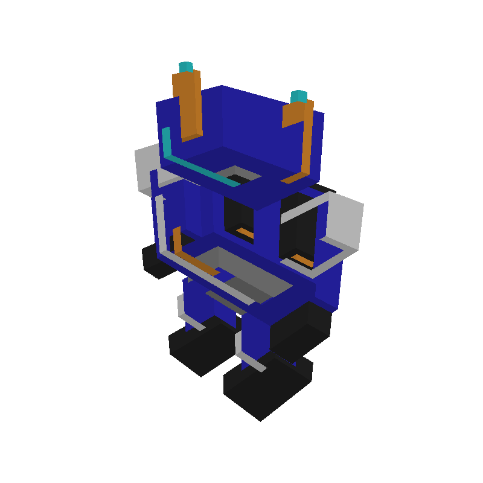

# EsperaVox // LinuxVox Core

> **A Native, Lightweight Voxel Art Studio & Engine for Linux**  
> *Created by Jack & Esperanza*



[](https://github.com/JupyterJones/EsperaVox)
[](https://www.rust-lang.org/)
[](https://github.com/JupyterJones/EsperaVox/releases)
[](LICENSE)

---

## 🚀 Quick Start: Standalone AppImage (Recommended)

EsperaVox is distributed as a portable, self-contained **Linux AppImage** (~6.2 MB). It runs directly on Ubuntu, Debian, Fedora, Arch, Manjaro, openSUSE, and any modern 64-bit Linux distribution with **zero external dependencies**. No Rust or compiler tools required!

### 1. Download
Grab the latest `EsperaVox-x86_64.AppImage` from the [**GitHub Releases**](https://github.com/JupyterJones/EsperaVox/releases) page.

### 2. Run
Make it executable and launch it:

```bash
chmod +x EsperaVox-x86_64.AppImage
./EsperaVox-x86_64.AppImage
```

*(You can also simply right-click the file in your desktop file manager, check **"Allow executing file as program"**, and double-click to launch.)*

---

## 🛠️ Building the AppImage from Source

If you want to package your own AppImage locally from the repository:

```bash
./build_appimage.sh
```

This automated script will:
1. Compile the optimized release binary (`cargo build --release --bin esperavox`).
2. Strip debugging symbols (reducing binary size to ~6 MB).
3. Assemble the freedesktop-compliant `AppDir` with desktop entry and hi-res icon.
4. Package everything into `EsperaVox-x86_64.AppImage` using `appimagetool`.

---

## ✨ Features

* **Native Linux First:** No Wine, Proton, or compatibility layer needed. Instant startup with a tiny memory footprint (~30 MB RAM).
* **MagicaVoxel `.vox` Compatibility:** Native RIFF parser and serializer for seamless model import and export with full 256-color palette fidelity.
* **Pixel-Accurate Raycaster:** 3D DDA (Amanatides-Woo algorithm) for instantaneous voxel placement, face snapping, and editing normals.
* **Catmull-Rom Spline Cinematics:** Built-in camera keyframe director to produce silky-smooth crane, dolly, and 360° orbit fly-throughs.
* **Headless Video & Image Exporters:**
  * `vox2video`: Command-line automated turntable and crane camera video renderer directly to `.mp4`.
  * `vox2img`: Standalone raytraced 2D `.png` renderer with custom backdrops and transparent alpha support.

---

## 🏗️ Building from Source (Cargo)

### Prerequisites

You will need the Rust toolchain and standard Linux graphics/X11/Wayland development libraries:

```bash
# Ubuntu / Debian / Pop!_OS
sudo apt install build-essential pkg-config libx11-dev libxcb1-dev libxcursor-dev \
                 libxrandr-dev libxi-dev libxkbcommon-dev libwayland-dev libgl1-mesa-dev ffmpeg
```

### Running the Desktop Studio

```bash
cargo run --bin esperavox
# or simply:
./run.sh
```

### Building Optimized Release Binaries

```bash
cargo build --release
```
The compiled binaries will be located at `target/release/`.

---

## 🎥 Command-Line Tools

### Generate Turntable/Crane Video (`vox2video`)
```bash
cargo run --bin vox2video -- examples/Castle_Keep.vox Castle_Cinematic.mp4 --seconds 4.0 --fps 30 --mode crane
```

### Render Static Image (`vox2img`)
```bash
cargo run --bin vox2img -- examples/Retro_Bot.vox output.png --width 800 --height 800 --bg studio
```

---

## 📂 Architecture

EsperaVox is structured as a clean Cargo workspace:

* **`crates/esperavox`**: The desktop GUI studio built with `egui` / `eframe`, featuring the viewport, camera controller, tools, timeline, and palette docks.
* **`crates/linuxvox-core`**: The headless voxel engine containing dense 3D volume grids, raycasting, greedy meshing, `.vox` format I/O, and spline interpolation.

---

## 📜 License

Licensed under either of:
* Apache License, Version 2.0
* MIT license
